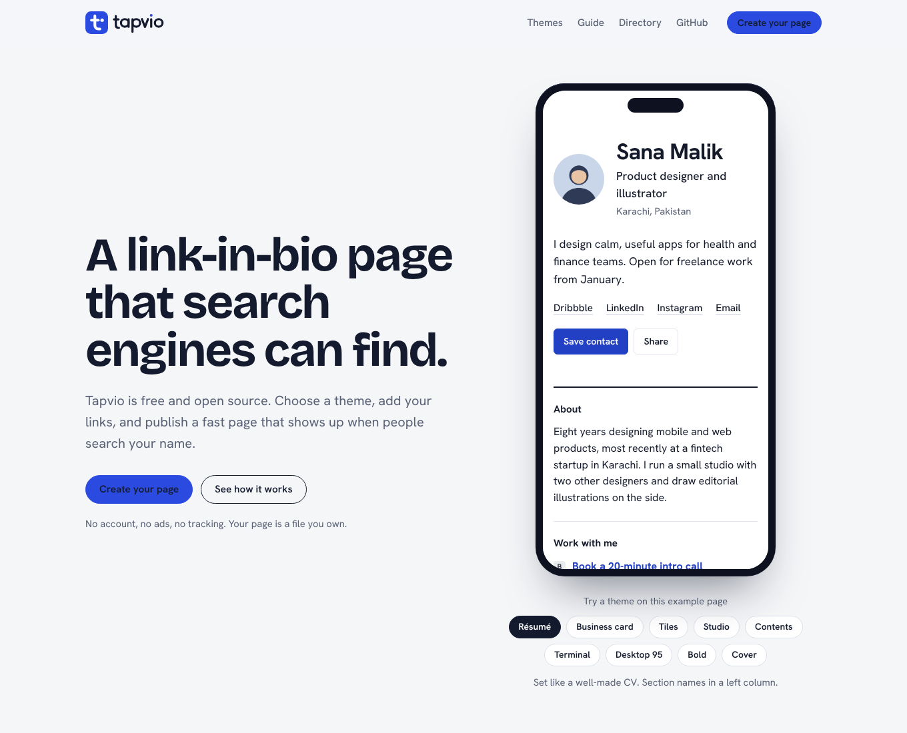
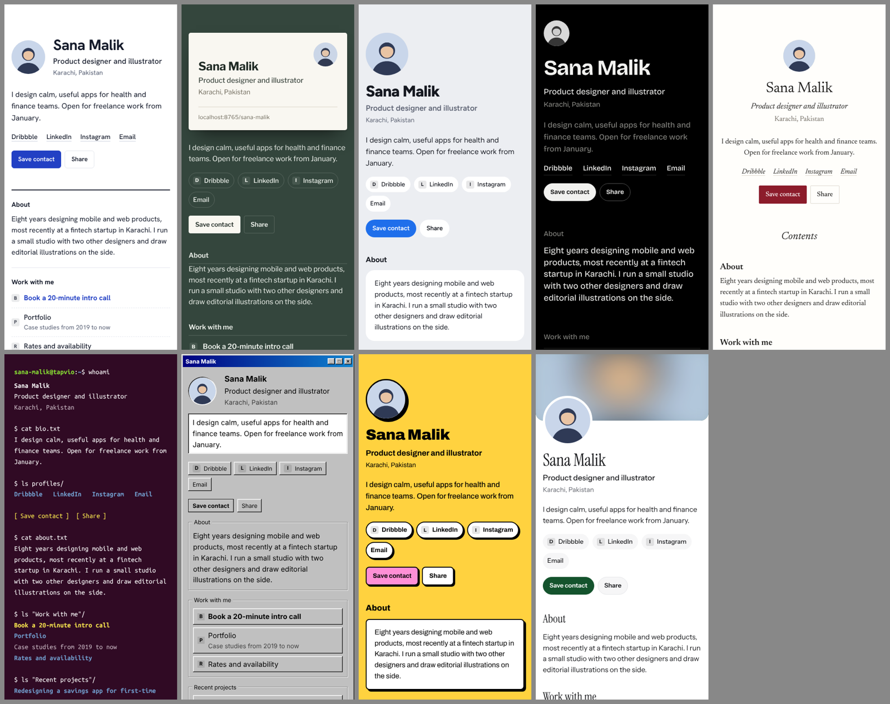

<p align="center">
  
</p>

<p align="center"><b>Free, open-source link-in-bio pages that search engines can actually find.</b><br>
Nine themes, real HTML, no ads and no tracking. Your page is a file you own.</p>

<p align="center">
  <a href="LICENSE"></a>
  <a href="https://github.com/mafzalkalwardev/tapvio/releases"></a>
  <a href="https://github.com/mafzalkalwardev/tapvio/stargazers"></a>
</p>

<p align="center">
  <a href="https://mafzalkalwardev.github.io/tapvio/">Website</a> ·
  <a href="https://mafzalkalwardev.github.io/tapvio/create/">Create your page</a> ·
  <a href="https://mafzalkalwardev.github.io/tapvio/guide/">Guide</a> ·
  <a href="https://dev.to/mafzalkalwardev/i-built-a-free-linktree-alternative-that-google-can-index-1d7j">Why I built this</a>
</p>



**Quick start** (Python 3.12, the version CI uses): `pip install -r requirements.txt && TAPVIO_SITE_URL=http://localhost:8000 python build.py --no-og && python -m http.server -d dist 8000`

Then open http://localhost:8000/.

## Why this exists

Most link-in-bio tools are built for social apps. The page they give you is often a script-heavy profile that search engines skip, and some of them send a `noindex` tag on purpose. That is a poor trade if the thing you want found is your name, your work, and the profiles you actually own.

Tapvio takes the other route. Each page is static HTML with a title, a description, a canonical URL and structured data. There is no database and no Tapvio account. The page is one YAML file in this repository. GitHub Actions checks it, `build.py` builds the site, and GitHub Pages hosts it. The longer version of that decision is in [I built a free Linktree alternative that Google can index](https://dev.to/mafzalkalwardev/i-built-a-free-linktree-alternative-that-google-can-index-1d7j).

## What is Tapvio?

Tapvio is a **free link-in-bio tool**: one short address that lists your website, social profiles, portfolio, shop and contact details. Put it in your Instagram, TikTok, LinkedIn, X or GitHub bio, your email signature, or on a business card.

Publishing uses a free GitHub account, because that is how the pull request is opened. After that, the page is yours: copy the file, fork the project, or point a domain at your own copy.

### Who it's for

- **Freelancers and job seekers** who want one professional page for Upwork, Fiverr, LinkedIn and their portfolio
- **Developers** who want a link page they control, in a repo, with a terminal theme
- **Agencies and consultants** who need a digital business card with a Save contact button
- **Creators, designers and photographers** who want a page that doesn't look like everyone else's

## Features

### Nine themes

Each theme has its own typography, layout and link style, not just a different colour.

| Theme | Look | Light/dark |
| --- | --- | --- |
| **Résumé** | Set like a CV, with section names in a left column | ✓ |
| **Business card** | A printed contact card on a felt desk | |
| **Tiles** | A grid of tinted tiles; featured links get a wide tile | ✓ |
| **Studio** | Your name set huge, links as large lines of type | dark |
| **Contents** | A book's table of contents with dotted leaders | ✓ |
| **Terminal** | An Ubuntu terminal; links listed like files | dark |
| **Desktop 95** | A Windows 95 window with bevelled buttons | |
| **Bold** | Thick borders and hard shadows on yellow | |
| **Cover** | A full-width photo banner with a large serif name | ✓ |



**Customization options:** light, dark or automatic mode (on the themes that have both); your own accent colour; ten font choices; cover image; photo shape (circle, rounded, square); website icons on or off.

### SEO and indexing

- Server-rendered HTML. Published profiles are not marked `noindex`. Each one has a unique title, description and canonical URL.
- **Structured data (JSON-LD):** `ProfilePage` and `Person` (with `sameAs` for every http(s) link, plus `worksFor` and `knowsAbout` when you set them), `BreadcrumbList` on the profile, `WebSite` and `SoftwareApplication` on the homepage, and `HowTo` on the guide.
- An auto-generated **1200 × 630 share image** for every published page, so links look right on LinkedIn, X, WhatsApp and Slack.
- `sitemap.xml` with image entries and git-based `lastmod` dates on profiles, plus `robots.txt`, an Atom feed and `llms.txt`.
- **IndexNow** ping after every deploy, so Bing, Yandex, Seznam, Naver and Yep are told about changes.
- A homepage directory that links to every profile, so crawlers can find new pages.
- Do-follow links for profiles a maintainer has marked verified; `ugc nofollow` for everyone else.

### Built for visitors

- **Save contact:** a vCard is generated when you add an email, phone or WhatsApp link.
- Share button, link search on pages with more than 12 links, a skip link, and `prefers-reduced-motion` support.
- The page does not load a JavaScript framework. The script on the page is a few lines for share, search, a broken-image fallback, and the homepage theme preview.

### Built for owners

- A **visual builder** with a live phone preview that publishes through a GitHub pull request.
- Your page is a plain file you own. Copy it, fork the project, or self-host it.
- Validation in CI, with the error written on the pull request.

## How it works

```
profiles/you.yml ──► GitHub Actions ──► build.py ──► dist/ ──► GitHub Pages
                      (validate PR)     (HTML, share image,        │
                                         vCard, sitemap)           └─► IndexNow ping
```

1. Someone fills in the [builder](https://mafzalkalwardev.github.io/tapvio/create/) and clicks **Publish on GitHub**. That opens a pull request adding `profiles/<username>.yml`.
2. The workflow runs `python build.py --check` and reports any problems on the pull request.
3. A maintainer merges it. The workflow builds the site, deploys it to GitHub Pages and pings IndexNow.

The full user guide is in [GUIDE.md](GUIDE.md). It's also published at [/guide/](https://mafzalkalwardev.github.io/tapvio/guide/).

## Add your page

Use the **[visual builder](https://mafzalkalwardev.github.io/tapvio/create/)**, or copy [`profiles/_template.yml`](profiles/_template.yml) to `profiles/<username>.yml` and open a pull request. See [CONTRIBUTING.md](CONTRIBUTING.md) for the rules.

```yaml
username: ali-khan
name: "Ali Khan"
headline: "Brand designer"
bio: "I design logos and websites for small businesses."
avatar: "https://github.com/alikhan.png"
style:
  theme: tiles
  mode: auto
socials:
  - { label: "Instagram", url: "https://instagram.com/alikhan" }
  - { label: "Email", url: "mailto:ali@example.com" }
sections:
  - title: "Work with me"
    links:
      - { title: "Portfolio", url: "https://alikhan.design", featured: true }
```

## Run it locally

```bash
pip install -r requirements.txt
python build.py --check                       # validate profiles
TAPVIO_SITE_URL=http://localhost:8000 python build.py --no-og
python -m http.server -d dist 8000            # open http://localhost:8000/
```

`--no-og` skips share-image rendering. `TAPVIO_SITE_URL` makes generated links point at your local server. CI installs these dependencies on Python 3.12.

## Deploy your own copy

1. Fork this repo, then go to **Settings → Pages → Source → GitHub Actions**.
2. Edit `config.yml`: `site_url`, `repo`, `owner_name` and `owner_url`.
3. Push to `main`. The workflow validates, builds, deploys and pings IndexNow.

### Free custom domain: `tapvio.is-a.dev`

[is-a.dev](https://is-a.dev) gives free subdomains to software projects. Its maintainers only accept registrations submitted by a person, not by AI tools.

1. Make sure the site is live on GitHub Pages first.
2. In your fork of [is-a-dev/register](https://github.com/is-a-dev/register), add `domains/tapvio.json`:
   ```json
   {
     "owner": { "username": "mafzalkalwardev" },
     "records": { "CNAME": "mafzalkalwardev.github.io" }
   }
   ```
   Then open a pull request in your own words.
3. Once it's merged: **Settings → Pages → Custom domain** → `tapvio.is-a.dev`, then tick **Enforce HTTPS**.
4. In `config.yml`, set `site_url: "https://tapvio.is-a.dev"` and `custom_domain: "tapvio.is-a.dev"`, then push. Canonical URLs, the sitemap and share images switch over, and the github.io address redirects automatically.

### Getting indexed by Google

1. In [Google Search Console](https://search.google.com/search-console), add a **URL prefix** property for your site URL.
2. Choose **HTML tag** verification, paste the `content` value into `config.yml` → `google_site_verification`, push, and click **Verify**.
3. Submit `sitemap.xml` under **Sitemaps**, and use **URL Inspection → Request indexing** for important pages.
4. In [Bing Webmaster Tools](https://www.bing.com/webmasters), import from Search Console. IndexNow keeps Bing updated after that.
5. Link to the site from places Google already crawls: GitHub profile READMEs, LinkedIn, Dev.to, Medium and Upwork profiles.

## Project structure

```
config.yml                site name, URL, repo, verification tokens, IndexNow key
profiles/*.yml            one file per page (_template.yml and _demo.yml are not published as profiles)
avatars/                  optional local images
templates/                Jinja2: profile, home, builder, preview, guide, 404, sitemap, feed, llms.txt
static/profile/base.css   shared structure for profile pages
static/profile/themes/    one stylesheet per theme
static/site.css           styles for the homepage, builder and guide
static/brand/             logo, wordmark, icons and social preview image
GUIDE.md                  user guide (also rendered at /guide/)
build.py                  validator, site generator, share images, vCards
scripts/indexnow.py       IndexNow ping, run by CI after deploys
```

### Adding a theme

1. Create `static/profile/themes/<name>.css` and scope every rule with `[data-theme=<name>]`.
2. Register it in `THEMES` in `build.py` with a label, description, Google Fonts query and share-image colours.
3. Run the build and check it at `/demo/?theme=<name>`.

## Brand

| File | Use |
| --- | --- |
| `static/brand/tapvio-logo.svg` / `-white.svg` | Logo with mark and wordmark |
| `static/brand/tapvio-mark.svg` | App icon and favicon |
| `static/brand/tapvio-mark-{32,180,256,512}.png` | PNG icons |
| `static/brand/tapvio-social.png` | GitHub social preview (1280 × 640) |

Colours: cobalt `#2B4BE0`, ink `#141B2E`, paper `#F5F6F8`. Fonts: Bricolage Grotesque (headings) and Hanken Grotesk (text).

## Contributing

Profile pages and code changes both start in [CONTRIBUTING.md](CONTRIBUTING.md). Please read [CODE_OF_CONDUCT.md](CODE_OF_CONDUCT.md) before you post.

## Releases

See [CHANGELOG.md](CHANGELOG.md) and the [releases page](https://github.com/mafzalkalwardev/tapvio/releases). To publish a release, add a section for the new version to `CHANGELOG.md`, then push a tag: `git tag v1.1.0 && git push origin v1.1.0`. The release workflow publishes the notes and attaches the brand kit.

## License

MIT © INDUS Web Agency. Fonts are © their authors under the SIL Open Font License. Inter is used for share images.

If this helped, a star helps others find it.
